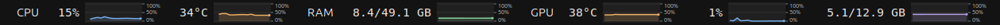

# Panel Graphs

A small GNOME Shell extension that puts CPU, RAM and NVIDIA GPU readings next to the clock, with live history graphs.



- Refreshes every **1 second**.
- Each graph shows the **last 15 seconds** on a fixed time axis. History builds from installation or login; it is not saved to disk.
- **CPU:** utilization, then package temperature.
- **RAM:** used/total capacity.
- **GPU:** temperature, utilization, then video memory used/total.
- One heading per group, colored line graphs, and no root helper or background service.
- Fixed-width numeric spaces keep graphs stationary when readings gain or lose digits.

## Compatibility

Tested on Ubuntu 26.04.1, GNOME Shell 50, an Intel CPU and an NVIDIA RTX 3060. Only GNOME 50 is currently declared supported.

CPU utilization and RAM come from `/proc`. CPU temperature currently requires Linux's Intel `coretemp` sensor and its package temperature/critical-limit files. GPU readings require a working `nvidia-smi`; the first GPU is displayed. AMD/Intel GPU monitoring and other CPU temperature drivers are not implemented. Unsupported readings display `N/A`; supported readings continue updating.

Memory uses decimal **GB**, so a GPU sold as having 12 GiB can appear as 12.9 GB. RAM used is total minus `MemAvailable`, which excludes reclaimable memory from the used amount. Utilization and memory graphs use a fixed 0–100% scale. CPU temperature uses its reported critical limit; GPU temperature uses 0–100°C. Each graph has 100%, 50%, and 0% scale labels on its right; temperature percentages refer to those temperature limits. The clock and graph layout are intended for a desktop-width panel.

## Install

Requirements: GNOME Shell 50, Python 3 for packaging, and NVIDIA drivers providing `nvidia-smi` for GPU readings. No npm packages or Vitals installation are needed.

From the repository directory:

```sh
./scripts/install.sh
```

Log out and back in after installing or updating, then enable it if necessary:

```sh
gnome-extensions enable system-bars@local
```

GNOME caches loaded JavaScript modules; disabling and enabling alone may not load an update. The extension UUID is `system-bars@local`.

## Build a shareable ZIP

```sh
python3 scripts/build.py
```

The result is `dist/system-bars@local.shell-extension.zip`. Recipients can install it with:

```sh
gnome-extensions install --force path/to/system-bars@local.shell-extension.zip
```

Then log out/back in and enable it as above.

## Remove

```sh
gnome-extensions disable system-bars@local
gnome-extensions uninstall system-bars@local
```

## Development and checks

```sh
node --test tests/*.test.js
python3 scripts/build.py
```

The tests cover the 15-second window, bounded history, invalid samples, and fixed time axis. Node is used for tests only. Rendered graphs must also be checked in an actual GNOME session; Node cannot exercise GNOME's UI APIs.

Source files:

- `extension.js`: lifecycle and asynchronous sensor polling.
- `layout.js`: grouped labels and readings.
- `graphs.js`: Cairo line/area rendering.
- `history.js`: pure history and time-axis calculations.

At one-second intervals, GPU polling launches `nvidia-smi` once per second. Actual overhead depends on the driver and system. There are no network requests or telemetry.

## Contributing

Bug reports and pull requests are welcome. Include your GNOME version, Linux distribution, CPU/GPU model, and relevant extension errors from `journalctl --user`. Useful additions include AMD sensors, other GPU backends, configurable layouts, and testing on other GNOME versions. Please avoid posting logs containing private information.

## License

[MIT](LICENSE).
